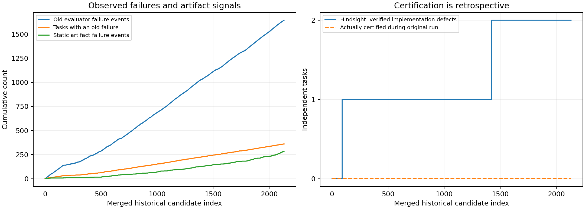

# E3-S0：历史失败事件流与时间顺序回放

完成800题、2,132份历史程序的离线事件重建；未调用模型，也未重新执行候选程序。结果基于全部原始请求/响应/判定与已有重评分、逐题审查证据。

原评测失败事件1644个，涉及360道题；最终失败312题。它们是观测失败信号，不能直接视为真实算法错误。原运行中的失败机制库大小始终为0，实际积累并复用的是旧评测判成功的解。

## 事件与时间

每份历史程序形成一个事件，保留task/stage、源码哈希、请求/响应/判定哈希、旧反馈与错误码、原始时间戳、模型成本、修复父节点、成功解引用来源，以及事后可信性覆盖。原始created是请求时期时间；判定可用时刻采用服务器原始verdict文件mtime。该mtime为观察证据而非签名日志，未把归档解压时间当历史时间。

8条dataset×difficulty题流独立顺序处理；跨流按判定mtime稳定合并，仅用于画总曲线，不模拟一个跨流共享库。同秒/重叠API请求不代表严格全序因果；因果结论以流内顺序与实际请求内容为准。

逐项检查源码与3份独立清单哈希、响应提取结果、判定一致性、阶段顺序、时间偏序、成功即停止、库容量和检索内容。共有0条未通过检查，详见 integrity_checks.json。

## 历史信息回放

l1/l2a/l2b属于重新生成；l3/l4才收到上一候选及旧反馈。成功库按同流此前旧PASS题的题面前200字符做词重叠检索，引用解答前500字符。逐条复现检索算法并核对原始请求后缀。l3只收到l2b、l4只收到l3，不能把此前所有失败都算作模型已获得的信息。

恢复640条上一候选/反馈边和624条前序成功解引用边；所有来源与目标保留在dependency_edges.jsonl。引用来源的旧PASS并不保证其全输入域正确。

LCB错误码解释另行核对：51个事件存在-2/-3误译，其中17条误译反馈实际进入l3/l4。-4仍保留程序/框架异常歧义，不擅自改成算法错误。误译检查只确认反馈语义，不证明输入和标准答案可信。

## 可信性分层

|证据层|事件数|
|---|---:|
|UNVERIFIED_BENCHMARK_VERDICT|1704|
|VERIFIED_ARTIFACT_FAILURE_NOT_ALGORITHM|284|
|PASS_ON_AUDITED_FINITE_SUITE|142|
|VERIFIED_IMPLEMENTATION_FAILURE_ON_INDEPENDENT_LEGAL_INPUT|2|

静态可确证的空/语法错误产物共284次，涉及130题；它们是产物失败，不是功能算法机制。可信有限测试只覆盖155份程序。其余旧WA/异常不因重新评分后仍失败就升级为算法失败。

E1证据只有当源码哈希精确匹配时标记到事件；其他阶段仅保留题级背景。旧失败新PASS和旧PASS新失败仅标为规则敏感。时间上，E1/可信集证据均来自事后，绝不写入历史时刻的真实机制库。

新旧规则敏感：旧失败→重评分PASS 378次；旧PASS→重评分非PASS 20次。两种评分都不是完全认证的真值。

## 在线积累曲线

左图：随历史候选到达累积的旧失败事件、失败题数和静态产物失败。右图：事后证据投影出的2个真实实现缺陷，与原运行当时已认证机制数0分开显示。在线shadow候选只读取当前及更早反馈、截断元数据和静态语法；不读取未来阶段、后验标签、后续修复或隐藏反例。

合并时发现1个纳秒时间戳并列，按流名及流内序号稳定排序；不据此推断跨流先后因果。

因此右图的2条增量不能称为历史运行当时发现了2个机制。它们只有在事后独立证据到位后才可用于未来实验。online_accumulation.csv同时保存全局和8条流的逐事件计数；per_stream_accumulation.png提供分流曲线。

## 机制候选库

|候选|事件数|独立题数|证据|可进入算法失败机制库|
|---|---:|---:|---|---|
|unresolved_wrong_answer|1057|255|UNRESOLVED|否|
|evaluation_rule_sensitive|378|91|OBSERVED_RULE_DISAGREEMENT|否|
|unresolved_execution_error|296|96|UNRESOLVED|否|
|unresolved_timeout|15|7|UNRESOLVED|否|
|artifact_empty|276|127|DIRECT_ARTIFACT|否|
|output_budget_exhaustion|284|130|DIRECT_RESPONSE_METADATA|否|
|E1_exact_code_evaluation_problem|72|71|PRIOR_CASE_REVIEW|否|
|memoized_tree_depth_recursion_resource|1|1|VERIFIED_LEGAL_WITNESS|事后可用|
|old_failure_but_audited_suite_pass|134|29|FINITE_SCOPE_ONLY|否|
|LCB_feedback_category_mistranslation|51|15|VERIFIED_CODE_TRANSLATION|否|
|artifact_syntax|8|8|DIRECT_STATIC_PARSE|否|
|alphabet_combinatorics_table_capacity|1|1|VERIFIED_LEGAL_WITNESS|事后可用|

候选可重叠，行数不能相加当独立失败数。WA、超时、错误反馈、预算耗尽是待核查的信号/候选类别，不自动是算法根因。唯一达到合法反例+实际异常+局部反事实修复门槛的仍是阶乘表容量不足与长链递归资源不足，两者属于实现缺陷。没有新增确证的算法选择或状态转移机制。

可信集连续候选出现PASS→非PASS 4次（见audited_suite_regressions.json）。只有direct_repair=true才是直接修复边；即便如此，该指标仅说明有限测试退化，不能仅凭相邻阶段就证明后续修复改坏了原本全域正确的算法。

## 8条独立题流

|题流|题数|程序数|旧最终PASS|原失败库|
|---|---:|---:|---:|---:|
|lcb_easy|100|100|100|0|
|lcb_hard|100|185|83|0|
|lcb_medium|100|133|95|0|
|taco_EASY|100|315|49|0|
|taco_HARD|100|373|35|0|
|taco_MEDIUM|100|338|41|0|
|taco_MEDIUM_HARD|100|352|41|0|
|taco_VERY_HARD|100|336|44|0|

## 输出与复核

- events.jsonl：2,132个候选事件；dependency_edges.jsonl：实际信息流。
- online_accumulation.csv：逐事件累积；两张PNG和总览SVG。
- mechanism_candidates.json：候选、证据等级、来源事件及准入状态。
- task_memory_replay.jsonl：800题的成功库重建。
- integrity_checks.json / source_hashes.json：一致性与原始文件摘要。
- candidate_transitions.csv：全部1,332条同题相邻候选变化。
- replay_policy.json：时间、信息隔离与事后证据策略。
- raw/runs：全部原始程序、请求、响应、判定与结果；不含API密钥。

本轮不开展新修复、重新评分或因果效应试验。S0给出的机制候选需要独立合法反例审查后才能升级；不能用症状聚类数量代替可信机制数量。

两个已验证机制各仅有1道来源题，尚无跨题复现证据，不能声称已建立可迁移机制规律。其余10类是分诊候选或评分问题，不是10种已验证算法机制。

这两个缺陷均来自l1中间候选，原运行后来分别在taco_0875的l3、abc301_f的l2a得到旧PASS；它们不是312道旧最终失败题中新增确证的两个终态失败。失败事件流覆盖所有尝试，因此能保留此类被最终成功掩盖的历史失败。

独立复核脚本verify_replay.py进一步检查所有来源文件哈希、1,264条依赖边，并仅用允许的当时可见字段重算全部2,132个前缀，结果见replay_verification.json。Python3.10原运行环境静态解析全部程序，与本地解析分类一致；没有执行候选。
