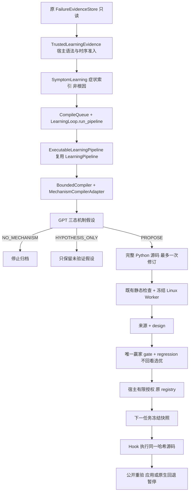

# 自主可执行算子学习：实现与接口

基线：8ff0e7ac34a87ce9ccda6dafdf0da32b1cc35832；2026-10-27；本轮零模型 API。

## 调用链

## 修改及新增文件

| 文件 | 变化 |
|---|---|
| trusted_learning_evidence.py | 版本化宿主输入验证器；时序、来源与代码绑定；追加准入/勘误；不信任 legal_verified 标记 |
| autonomous_mechanism.py | 三态严格机制 schema；独立 GPT 型号/版本/费率配置；原预算与最终 wire 预检 |
| autonomous_pipeline.py | 扩展现有 LearningPipeline 的实际源码执行、来源/独立验证、版本记录、有限授权和后续 Hook |
| autonomous_generation.py | 复用已有三对象与 GPT 请求审计；schema/parser/协议可覆写 |
| autonomous_mvp.py | 复用原实际执行器，增加 task_solver 空候选来源验证模式 |
| learning.py | run_pipeline 可注入可信 public_builder；默认不变 |
| pipeline.py | 可选候选上限、三态归纳、失败才修订及宿主静态验证；原默认不变 |
| failure_registry.py / plugin.py | 单独受控 before_native_start，仅 task_solver + candidate_code；旧卡默认 Hook 不变 |
| workflow_runtime_v2.py | allow_task_start 默认 False；成功公开验证后可直接返回，否则原生五阶段继续 |
| scripts/test_autonomous_learning_v2.py | 真实历史失败→Mock生成→真实Worker→有限授权→未来任务验收 |

此前 compile_queue.py 最终 wire 计量修复保持有效；不是本轮新研究结果。

## 正式执行契约

`repair_operator(context)` 返回 `applied + candidate_code`、`declined + reason` 或 `error + reason`。不接受模型修复请求。code_repair 在重试前做确定性程序变换；task_solver 在任务开始收到空候选，根据结构生成包含确定性算法的完整候选程序，由宿主在 Linux 执行。未实现直接数学标量答案协议。

宿主不替算子实现等价算法。运行时调用登记源码，核对 SHA256；返回程序再次独立运行公开测试。进程不接收模型密钥、注册表或封存答案；资源与静态权限复用原 Worker。生成器可见来源公开反馈，但独立门控答案不进入生成请求。

`InputValidator` 绑定题目、题面 hash、实现文件 hash、版本、范围及依据，实际调用可信宿主 check。未知语法返回 UNKNOWN；非法输入追加 EVIDENCE_ERRATUM。它是宿主信任边界，不是模型可自注册的验证器。原始证据不被覆盖。

`MechanismHypothesis` 保存来源、谱系、富结构假设、请求/响应 hash，状态始终 UNVERIFIED。支持 PROPOSE / HYPOTHESIS_ONLY / NO_MECHANISM。

`GeneratedOperator` 保存原始源码、模型、版本父链、源码及 wire/response hash、用量和报价估值；同源码重复仍保留每次成本。`OperatorValidation` 保存真实宿主静态、来源、gate、regression及预算/Worker结果。hypothesis_id 由宿主生成，模型不能自行认证根因或权限。

候选静态合法即可保留 Shadow；来源失效、独立失效或无独立数据均不可 Experimental。authorize 必须读取冻结 winner、独立正反结果及真实 Controller 回退收据。Mock 或工程数据只能获得 engineering: 命名空间授权。未来允许任务限定为 test 角色，排除 discovery/design/gate/regression；原 registry 负责题间生效、额度和暂停。

## 可核验记录示例

- engineering_attempt02/pipeline/hypothesis.json：真实历史来源，但假设内容为 Mock。
- engineering_attempt02/pipeline/pipeline.jsonl：生成原始源码、父链和检查日志。
- engineering_attempt02/pipeline/operator_validation.json：实际 Worker 结果。
- engineering_attempt02/pipeline/fallback_acceptance.json：实际 Controller 拒绝回退。
- engineering_attempt02/pipeline/roles.json：五角色清单。

测试夹具故意在 Mock 响应中使用人工完整程序及历史参考实现，并包含工程题分支；它们从不进入归纳请求，也不计自主生成结果。它们用于检验宿主是否执行发送器返回的原始源码，不能证明通用算法学习或自然泛化。

## 尚存边界

- 仅 stdio 编程任务；数学 gold 反馈路径未接入。
- 题目语法验证器仍须人工审核与冻结；不是通用合法输入证明器。
- 已有修复保留 repair_evidence_ids 可追溯引用；本版没有自动展开任意历史修复结果全文。正式归纳需另行冻结当时可见投影。
- 来源题号硬编码检查只是有限 AST/literal lint，不是抗作弊语义证明；还必须依靠独立验证与人工审查。
- 原始反馈侧车由可信宿主提供；源码、时序、事件绑定不等于对任意输入侧车的自动真实性认证。
- 没有修改默认长流入口，也没有启用旧 Suspended 制品。
