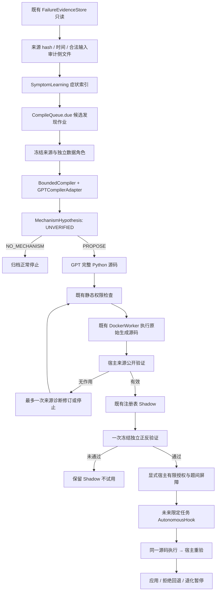

# Autonomous Operator Learning MVP：P0/P1 实现与零 API 验收

日期：2026-10-27。代码基线：`8ff0e7ac34a87ce9ccda6dafdf0da32b1cc35832`。

**结论：最小工程闭环通过本轮验收；H1 尚未检验。新增真实 GPT/DeepSeek 请求均为 0。**

本轮只增加可选择启用的模块和验收脚本，未修改现有 Controller、DeepSeek 默认求解行为、权限策略或 S19–S24 历史结果。没有恢复历史 Suspended 制品，没有启动大规模任务流。Mock 人工源码只存在于测试文件；不是自动归纳的算法，不计作学习成功。

## 1. 文件与接口

| 文件 | 作用 |
|---|---|
| `FlowEvo/src/failure_evo/autonomous_generation.py` | 三个数据对象；GPT Responses 适配器；严格假设/源码契约；授权和发送记录 |
| `FlowEvo/src/failure_evo/autonomous_mvp.py` | 可信来源投影、发现作业、生成/验证编排、冻结 Linux 执行、有限发布、Hook |
| `scripts/test_autonomous_mvp.py` | 固定 Mock 响应及真实 Linux 工程闭环测试 |
| `scripts/accept_autonomous_mvp.py` | 真实历史 FailureEvidenceStore → 生成 wire 的只读零 API 验收 |

新增正式运行接口仍是 **`repair_operator(context)`**，兼容现有 `FailureOperator` 与 Worker。必须返回以下之一：

```python
{"status": "applied", "candidate_code": "完整候选程序源码"}
{"status": "declined", "reason": "拒绝理由"}
{"status": "error", "reason": "执行错误"}
```

不接受 `request_repair`、模型调用、权限修改、自报验证成功，也不接受本 MVP 之外的动作。模型自己提出并实现确定性计算或程序变换；宿主没有实现测试算子的等价算法。计算结果通过新的候选程序提交，由宿主公开评分。

`runtime_projection` 提供当前程序、公开状态/异常类型、题面/签名及预算摘要。不给评分答案、测试文件、模型工具、注册表或文件句柄；候选账本为空。原题题面中的样例属于允许公开题面，不能当作封存泄漏。来源归纳输入可以含历史公开 expected/actual；运行时检查集合和答案不进入算子进程。

## 2. 数据对象

- **MechanismHypothesis**：来源事件、原题/谱系代理、共同失败、模型提出的根因、类别、可执行化建议、适用/排除条件、不确定性、请求/响应哈希、origin。状态固定 `UNVERIFIED`，没有模型自我认证接口。`NO_MECHANISM` 为正常结束。
- **GeneratedOperator**：来源假设、模型提出的类别、原始完整源码、代码哈希、接口/输入输出描述、拒绝条件、模型/响应 ID、请求响应哈希、用量、保守费率估值、版本及修订父哈希。Mock 的 origin 明确为 `MOCK`。
- **OperatorValidation**：静态检查、实际执行的原始/修改后公开结果、来源与独立正例、负例、逐例退化、用时/工具预算、准入判断和证据级别。费用估算不是供应商账单。

## 3. 完整调用图



这里使用原有 `CompileQueue.due` 发现接口，而不是把 A/B 调度器的修复动作作为新算子的目标。症状索引仅组织证据，不声明共同根因；未修改既有学习优先级。发现来源由显式冻结的 checkpoint 清单决定。

## 4. 真实历史输入重放

正式记录：[historical_replay_accepted/acceptance.json](historical_replay_accepted/acceptance.json)。

使用已有 S23 协议第一条来源对应的 **S19 原始最早失败** `s18_taco-test-91:l1`。这里只为验证代码路径，未按生成结果选题，也没有调用模型。

- 原始事件 `3d4039df…3195`，源码 SHA256 `d55d8636…0c50`。
- 时间截止 `1792829908.4905338`；仅该历史时点已可见公开状态。
- 3 个公开输入通过已有题目合法性语法核对。
- 不读取 S23 干预结果或最终封存结果；不把原症状当作已认证根因。
- final wire：27,277 字节；wire 保守上界 27,533；BoundedCompiler 实际较严上界 30,015，均低于 32,768。
- 请求 SHA256：`4d67aba8f42af3a8fd2a6bd18ce08d2cc198205240d85e78c98112473d9048f5`。
- 无授权真实适配器在预算预留/发送前拒绝；模型请求 0。
- 原事件账本、原源码和原协议前后哈希一致。

发现输入不包含算子名称、人工目标算法、旧双算子实现、未来任务或独立答案。允许模型拒绝形成机制。

## 5. 零 API 工程验收

[新增测试日志](tests.txt)：**17/17 通过**，包括真实 Linux Worker 测试，无跳过。

[既有核心回归日志](regression_tests.txt)：**198/198 通过**。

[安全与资源探针](worker_safety.json)：**12/12 通过**，复用原探针和原 Worker。

| 必需场景 | 实际检查 |
|---|---|
| 没有共同机制 | Mock NO_MECHANISM，1 次模拟归纳后结束，无源码生成 |
| 机制存在但源码无效 | 静态禁止 import os，未执行/未准入 |
| 源码合法但来源无效果 | 真实 Worker 返回 declined，未进入准入 |
| 来源通过、独立失败 | 真实程序执行结果失败，保持 Shadow |
| 独立通过、未来触发 | 实际 Controller 首轮失败后，Hook 执行响应中的源码并公开通过 |
| 不适用任务 | 实际源码返回 declined，保留原程序/原生路径 |
| 退化暂停 | 原本公开通过的程序被 Mock 错改；宿主捕获、回退、暂停；后续快照为空 |
| GPT 中断/未知 | 模拟异常；持久账本 UNKNOWN 预留保留；重建后同请求不重发 |
| 未授权 | 真发送模式在 preflight 阻断；发送器和预算计数保持 0 |
| 同题自用 | 当前发布序号无卡；来源/独立验证题被排除；只允许未来冻结任务清单 |
| 关闭模块 | 同一模拟时钟/请求下与无插件原 Controller 完全一致 |
| 预算/篡改/修订 | 额度耗尽前拒发；篡改源码拒绝；仅一次修订，父 SHA 精确关联 |

Docker 镜像 `sha256:cce12316475d7d56d605f76e1d811d0dc4e7227f2d4afd29951521264f504ff8`；Worker SHA `a32629562386b360a162a69ecbc599a7e521dc69dd54aaccf158d5a0b1661493`。禁网络、只读、非 root、256MB、1 CPU、32 PID，既有隔离限制不变。Worker 脚本每次调用检查哈希。

首次联调发现系统临时目录不在 Colima 共享范围，已按项目既有方法将 TMPDIR 设置为报告目录；未改 Worker 权限。现已将基础设施错误与源码编译错误分开，基础设施错误停止，不登记为功能失败。

## 6. Mock 来源和版本记录示例

持久示例：[engineering_accepted/m/hypothesis.json](engineering_accepted/m/hypothesis.json)、[generated-v0.json](engineering_accepted/m/generated-v0.json)、[validation.json](engineering_accepted/m/validation.json)、[future_controller_result.json](engineering_accepted/future_controller_result.json)、[registry.jsonl](engineering_accepted/registry.jsonl)。

Mock 响应由测试作者编写，做简单标记替换；**它不是 GPT 学出的算子**。工程测试使用 `EngineeringEvidence` 测试替身模拟宿主可信证据，磁盘上的事实仍标记 synthetic。该替身只在测试脚本中，真实历史重放使用原 `FailureEvidenceStore`。

模拟响应原文 → `GeneratedOperator.code` → 写入 `.py` → SHA 校验快照 → Docker 挂载 → `repair_operator` → 新程序 → 第二个 Worker 验证。测试断言保存源码与响应源码逐字一致。宿主只负责调度/评分，不替代执行标记替换。

Mock 准入只允许 `engineering:` 实验/流命名空间；真实研究授权明确拒绝 MOCK。准入和暂停使用原注册表，不生成新的代际机制。工程示例最终为 Suspended，不存在研究可用的 Experimental 制品。

## 7. 数据与发布边界

- 来源事件、代码、任务、时间、合法性审计绑定；未知字段、未来事件和变更源码拒绝。
- 源/独立任务 ID、谱系代理和原始代码哈希重叠被拒绝；正负验证任务不得重叠。
- 独立正反材料在生成前冻结，只存在宿主 plan；不进入归纳、源码生成或修订 wire。
- 来源失败允许最多一次修订；独立 gate 失败不能换候选重试同一 gate。
- 源码通过静态检查不等于有效；来源无效版本保留生成档案，来源有效才注册 Shadow。
- 未来授权需要显式独立 task→lineage 清单、未来序号、有限额度；当前及开发验证任务不能使用该版本。
- 异常或拒绝保留原生路径；已知公开退化由既有插件暂停。
- GPT adapter 真实模式要求 run/protocol/model/货币上限绑定，且发送前必须存在 BoundedCompiler 持久预留。无自动 HTTP 重试。

## 8. 尚未通过 / 有意未实施

1. **未测试真实 GPT 自主发现、代码生成成功率或 H1**。不能由 Mock 推断迁移收益。
2. 尚未冻结真正 H1 独立任务池、真实 GPT 响应及真实源码；需要在看输出之前选择独立任务/负例并完成合法性及判分验收。
3. 本 MVP 的内置功能验收仅支持 stdio + tokens 比较。函数题、特殊 checker 不自动纳入；必须使用经过单独验收的评分适配，不能放宽本次标准。
4. 源码通用性、语义保持、未检测到的硬编码不能靠静态检查完全证明；独立控制只提供有限经验性证据。
5. 谱系 ID 是宿主审计代理，不是数学上的独立性证明；近重复仍需事前任务审计。
6. 增量假设/源码可能导致后续 wire 超限，此时 NOT_SENT 停止，不扩大上限或自动压缩到失真。
7. 当前以显式 API 组装接入现有 Controller/plugin；没有把旧实验 CLI 默认切换为新模式，没有新建长期调度框架。
8. 没有长期收益、复杂路由、老年代优化、大规模数据适配或 29.31 个百分点复现。

后续预算建议见 [API_Experiment_Proposal.md](API_Experiment_Proposal.md)。本轮不发送付费模型请求。
