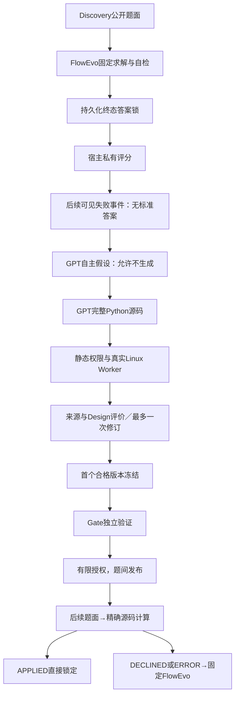

# P0：无Gold接口与闭环



## 数据边界

`PublicMathTask(task_id, problem)`拒绝gold、参考解、类别、种子等额外字段。模型messages只用题面和自身未经验证的上一轮输出；不传task_id或分组标签。私有评分器必须找到实际持久化的 `MATH_ANSWER_LOCKED` 及匹配哈希才评分，不能提供中途反馈。

`MathFailureEvidenceStore`要求真实终态评分收据和轨迹哈希、来源标签匹配，仅接受Discovery。评分只返回正确性及置信类别；明确有理数不一致才进入当前可信失败流，符号非匹配保留为未确认。Mock不能进入真实归纳。事件只在完成序号之后可见。

T与F使用相同选中来源题面、同模型/次数/资源上限。T不见失败轨迹、错误类型或评分；F看完成后的失败事实和轨迹。宿主固定选择最早最多6个不同题面的可信失败，未按历史机制名挑选；每段轨迹最多2400字符，明确标片段并记录完整原文SHA。所有原文保存在宿主。最终wire仍检查保守输入上界；超限不扩上限、不再反复压缩。

## 执行契约

```python
def math_operator(context):
    # context精确只有problem；完整计算必须由生成模型实现。
    return {'status': 'DECLINED', 'reason': 'unsupported'}
```

允许结果为 `APPLIED/answer`、`DECLINED/reason`、`ERROR/reason`，仅这两个字段，值为字符串。静态检查不证明语义正确；Worker禁止网络、文件宿主访问、提权、模型调用，限制256MB/单CPU/32进程/2秒计算。挂载只有精确源码和固定Worker。源码哈希不符即停止。真实GPT制品运行必须绑定工具预算。

运行时依次执行已冻结合格源码，仅靠算子自己从题面判断适用性；没有手工专项路由。第一个APPLIED直接锁定，不能根据私有判错再调用FlowEvo。默认关闭时不调用任何算子。

## 版本与验证

机制对象记录来源事件、题目与谱系代理、GPT假设、请求/响应哈希，状态始终UNVERIFIED。GeneratedOperator保存完整模型源码、调用规格、排除条件、精确哈希、版本/父链、模型响应和usage。实际Mock示例见 `acceptance04/fixtures/test_real_worker_end_to_end/pipeline/learning.jsonl`，所有示例标MOCK，不是真实学习结果。

每组最多3个候选，每个一次失败驱动修订。预定选择方式为**首个来源＋Design合格版本**，随后停止生成并冻结唯一赢家；未合格候选保留Shadow。来源及Design都要求至少一个正确APPLIED、无错误APPLIED/ERROR，并通过两个不适用工程拒绝控制。Gate使用相同保守正确性门槛；Gate失败保持Shadow，不尝试同批Gate上的另一个候选。

准入要求真实宿主开发与Gate日志收据、冻结事件和源码哈希绑定；模型自报通过不授予权限。来源/Design/Gate任务ID全部排除后续试用，发布序号必须严格晚于授权序号。暂停覆盖剩余额度。正式测试阶段禁止根据分数学习或改版本。

这是单候选链的最小闭环，不声称已实现多机制最优路由、长期晋级或数学语义证明。
