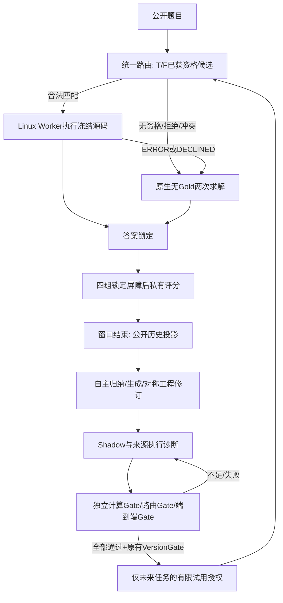

# 学习、验证与路由

## T/F 的信息对照

每个固定窗口使用同一历史公开题目视图：按与结果无关的规则，从窗口末尾取至多6题、题面总计不超过16000 UTF-8字节，再恢复时间顺序。省略题ID留在宿主审计引用中。T只有题面；F额外获得选中题中的可信最终错误、二值false和实际轨迹。题目不按F失败挑选，不向T泄漏失败池身份。两组可带自身此前至多2份未验证假设。

完整历史轨迹仍保存；模型输入中的截取明确标记 is_fragment 并绑定原文hash。未选中的失败不会伪装成已被模型读过。当前学习输入是窗口的有界视图，不是所有20题全文；这限制覆盖度，必须在长期报告中统计被省略的错误。

共享模型、输入输出上限、候选数量和工程修订机会：一次归纳；PROPOSE才生成一个候选；至多一次工程修订，总计每组每窗口≤3请求。F无选中可信失败则正常跳过；T仍可学习，不能为了对齐次数强迫F生成。归纳允许NO_MECHANISM/HYPOTHESIS_ONLY。仅数学专项代码由模型生成，宿主不填算法。

## 完整调用图

## 源码、资格与证据

契约沿用现有 solve(parameters) 与 match(problem)。模型生成的同一完整源码原样保存在组件工件，分别执行接口；契约声明、源码SHA和联合SHA绑定。静态、字段与安全错误提供相同工程诊断；AST实质改变标为新版本，旧资格不继承。不能把工程修订称为数学等价修复。

来源检查通过真实Worker执行生成源码，宿主评分只在锁定后做诊断，不回流生成请求。没有独立参数标签时明确参数正确性、计算正确性UNVERIFIED，不能把联合答对当成参数映射已独立证明。

发布需要预先独立审查且绑定当前工件的Development/Gate包：语义支持标签、正确参数、可信Oracle哈希、原题ID、时间界限、彼此独立。最大12条Development、6条Gate；Gate任务不得被生成器读过。来源原题UNKNOWN不能晋级。三Gate分别记录计算、真实题面路由和无Gold原生对照的端到端收益，且沿用既有VersionGate。截断或不可确认的原生答案不能伪造端到端优势。

通过后仅未来至多20个已核实原题可获有限试用；来源题、当前窗口均不能使用新候选。多算子使用现有质量排序与同级冲突回退，不按注册顺序硬选。在线反馈只能在任务锁定评分后写回，绑定具体版本与实际调用；没有配对原生答案时不能把一次成功写成因果净胜。

## 尚未具备的真实条件

200题均未核实到竞赛年份/题号和谱系；目前没有为真实新候选准备独立审查包。真实smoke因此只能保留Shadow。工程fixture中的批准及未来调用证明连接能够运行，不证明任何真实模型候选已获资格或产生收益。现有match仍可能具有早期语义迁移局限，本轮没有发明新的语义专项规则。
