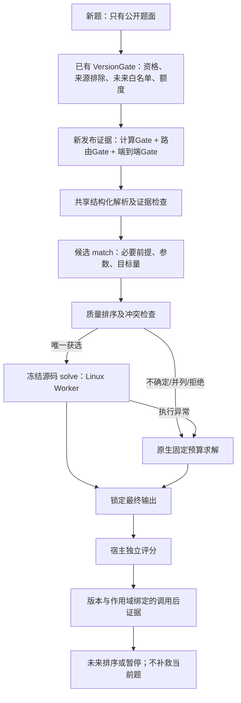

# 数学算子统一路由、发布与反馈闭环

结论：五个缺口的最小工程路径已补齐并完成零模型 API 验收。**工程可用，不代表自主学习算子已经取得真实跨原题收益。** 默认关闭，不迁移或提升历史 Shadow / Suspended 权限。

最终验收目录：`runs/math_unified_router_20261031_06`。37/37 项新检查通过；无 Gold 与旧 V3 回归测试共 37/37 通过。新验收真实 Linux Worker 执行 106 次，累计 22.071 秒；付费模型请求 0。模型、解析器及数学程序是明确标注的手工工程夹具。

## 五个缺口对应实现

| 缺口 | 本轮实现 | 工程验收与剩余研究证据 |
|---|---|---|
| 统一数学路由 | `math_router.py` 的 `UnifiedMathRouter`、`StructuredCandidateProbe`；复用 VersionGate、SplitRunner、语义证据 v2 和 NoGold Controller | 多候选适用性检查、目标量核对、排序、拒绝和回退已执行。没有添加数学关键词检索器。真实自然语言解析可靠性仍需独立检验。 |
| 质量—准入—排序 | `MathQuality`；计算、路由、收益证据独立，按版本和解析作用域聚合；独立原题去重、退化、异常、重复运行不稳定、Token/费用/工具耗时 | 高质量候选不依赖注册顺序获选；没有配对的成功不计为胜出。未知费用明确记录，不能视为已证明回本。 |
| 发布门槛 | `math_publication.py` 的 `MathPublicationGate`；分别记录 computation / routing / end-to-end Gate | 计算通过但全部拒绝不可发布；计算和路由通过但相对 Generic 无增益也不可发布。仍必须另有旧 VersionGate 的准入和有限未来任务授权。 |
| 多算子冲突 | 在计算前检查所有允许的候选；共享题面语义；目标量不一致不计算；最高质量并列回退 | 三个并存夹具验证了排序和冲突；违规契约声称 MATCH 时，目标量不一致仍阻断。不是三个真实学习算子的联合性能实验。 |
| 复用反馈闭环 | `record_outcome`、`record_feedback` 和无 Gold 运行入口的评分后 Hook | 实际执行→答案锁定→私有评分→版本绑定证据→后续排序/暂停。重复写入幂等、冲突重写拒绝、封存不能改标在线、负例治理可暂停。 |

## 实际执行路径

注册表仍为原 `VersionGate.events`，没有第二套数学生命周期注册库。私有 Gate 题目和答案保存在独立 host journal；运行注册表只有评价摘要、工件和哈希，不存评分答案。

## 路由与排序规则

1. 必须同时满足旧准入、有限未来授权和新三 Gate 发布证据。候选仍为 Shadow 时不执行。
2. 默认最多 8 个候选、9 次组件调用、30 秒调度时间窗；组件自身继续使用原 Linux 隔离和 2 秒执行上限。开始每个组件前检查时间，已启动组件由 Worker 超时控制。真实模式要求 PersistentBudget，工具请求先预留后执行；硬预算异常停止，不伪装成普通拒绝。
3. 解析接口接受题面对应的 MODEL_PARSE 包，复用证据类型、精确引用和未知前提规则。必要事实未知即拒绝。事实真实值可以超出算子支持范围。
4. 每个算子的 `match(facts)` 在 Worker 中执行。只有确认同一 `requested_quantity`、满足参数 Schema 的 MATCH 才进入排名。宿主没有预置数学目标名称或领域算法。
5. 排序先考虑已观察退化、执行错误、不稳定，再考虑独立原题胜出、Gate 净成功、可核算配对费用。不是把多维证据简单压成“40/40”一个数。
6. 并列最高候选不按哈希或注册顺序执行；选择原生求解。候选过多也安全回退，不静默截掉潜在冲突者。
7. 匹配探测也消耗有限试用额度。源码、契约、Schema、解析器冻结身份、路由实现或策略改变后，旧发布凭证不适用于新作用域/版本。

## 三 Gate 的证据含义

- **计算 Gate**：用独立审查的正确参数执行冻结算法；模型/算子看不到答案。
- **路由 Gate**：从公开题面实际解析、匹配和执行，分别记录正确接受、错误参数、拒绝、UNKNOWN、错误接受和异常。
- **端到端 Gate**：原生 G 与启用候选的流程用相同求解参数实际锁定答案，再独立评分；要求没有已观察回归，并有净正确性改善，或正确性不降且计入解析/执行开销后费用降低。

发布还要求支持题覆盖至少两个事前声明、经过宿主审查的原题 ID；同一原题重复运行不能充当多个独立来源。真实性和谱系独立性是数据审查责任，程序不能仅靠字符串 ID 证明。此次夹具中的 original_id 是工程标识，不能作为真实独立原题研究证据。

Gate 前冻结题目、角色、工件及价格；启动标志持久化；异常中断不能静默重跑。工程模式 Gate 结果不能用于生产路由。三关分开记录，拒绝一切输入不会获得准入。

本轮 Gate 验证单候选的收益，联合工程验收验证多算子选择行为。**真实多算子库整体的端到端收益尚未验证；正式改变库组成后仍需冻结联合实验，不能用单算子 Gate 相加替代。**

## 反馈隔离与计量

- 未来任务反馈用途在调用前冻结为 ONLINE_POST_TASK 或 SEALED_GOVERNANCE；不能看过结果后重新分类。
- 在线反馈只在任务完成后写入；查询后续序号才可使用。控制器按冻结任务序号顺序、单写者运行，不支持多进程并发调度。
- 必须存在实际路由执行记录、同版本结果、持久化最终锁和独立评分收据。仅有模型自报“正确”不接受。
- Generic 配对还核对题面哈希、协议和共同求解配置。无配对仅记录成功使用；不宣称因果收益。
- 封存结果不改变在线排名。外部治理需要显式 `governance_suspend`，保留封存失败收据关联。
- 已确认错误或执行 ERROR 触发保守暂停；不自动修改数学前提，不自动修订代码或晋级。
- 解析调用、输入/输出/推理 Token 进入 Controller 总计；SplitRunner 工具调用纳入 PersistentBudget。费用不可取得时标记未知，不写成“零成本收益”。本次没有真实学习/编译费用，因未调用模型；正式实验应另合并原始生成账本，不把在线费用当成完整生命周期成本。

## 新接口与启用方式

新增：

- `MathQuality.freeze_feedback_roles / summary / rank / record_outcome / governance_suspend`
- `StructuredCandidateProbe(split, semantics, parser, parser_identity=..., allow_mock=False)`
- `UnifiedMathRouter(registry, probe, policy=..., engineering=False)`，兼容原 Controller 的 `library.run(task, sequence=...)`。
- `MathPublicationGate.freeze / evaluate / publish`。

改动：

- `SplitRunner(..., budget=None)` 增加可选持久化工具预算；旧调用兼容。
- `NoGoldMathController` 记录题面哈希，并计入解析开销。
- `run_condition_no_gold(..., library=None)` 支持显式 `math_router_enabled=True`；要求事前提供 `math_original_ids`，评分后调用 `record_feedback`。默认关闭时继续原流程。

解析器是注入的宿主能力，须使用现有预算化模型传输，提供冻结型号/Prompt/配置身份和完整用量；不可传入可信离线语义作为正式解析。现有自由文本契约或单体 `math_operator` 不会被自动包装成已验证的结构化契约，仍需相应模型契约与 Gate 证据。

## 验收与来源

最终检查文件：`runs/math_unified_router_20261031_06/checks.json`；Worker 原始记录：`worker.jsonl`；预算：`budget.jsonl`、`budget_snapshot.json`；私有 Gate：`private_gate.jsonl`；注册与反馈：`registry.jsonl`；兼容性回归：`compatibility_tests.log`。

冻结了 70 份相关源码，保存在同目录 `frozen_source`，逐文件哈希在 `freeze.json`。最终重新核对全部哈希一致。前五次工程运行保留，最新版本以 `_06` 为准。

验收中的封存负例和在线负例暂停使用了**明确的评分故障注入**：故意给正确夹具输出配置不相同的测试评分值，以测试治理状态转移。这不是发现数学错误、不是学习证据，也没有进入真实经验库。工程源程序、JSON 题面和模拟解析器均为手工构造；不会标成模型自动学习结果。

AFlow 参考为本地现存的 `contextual_operator_router.py`、`operator_library.py`、`operator_tournament.py`、`router_end_to_end_experiment.py`、`joint_two_operator_confirmation.py`。用户指定提交在本地存在，但该提交不含所列路径；远程页面本轮也未成功读取。因此没有声称精确移植该提交。只参考检索/证据/联合验证的职责划分，未复制专用关键词、人工数学算法或旧算子权限。

## 尚未成立的研究结论

这次补齐的是让真实候选能够接受统一评价和安全试用的工程链路。没有重新生成算子、没有证明自然语言匹配可靠、没有真实多算子排名收益、没有证明自动跨原题正确率或成本收益。仍须使用真实模型生成且通过独立数据审查的候选，在冻结任务和公平对照下取得这些证据；失败结果同样允许保留。
