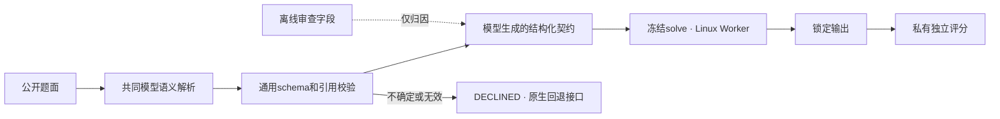

# V3.3 协议、数据与表示

本次定位是有限机制诊断。固定既有 F3 solve SHA `98d007cd20c01ae857e8b22839645c10a502f5723c5b0fc01bda141ff2ed0c61`，不生成或人工修改数学算法，不改变旧 R 匹配器。研究执行链为：

默认关闭；此次没有真正追加原生FlowEvo求解请求，拒绝记录不能称为回退后成功。沿用 BoundedCompiler、PersistentBudget、SplitRunner、FrozenLinuxBackend；未构建新Worker、路由或代际库。

新增开发12题、确认12题，各6支持、4不支持、2歧义。均在首个模型请求前固定。数学族仍是同一固定序列二元运算集合计数；新措辞和参数不等于不同自然原题。旧V3.2所有题仅算已曝光材料，未复用为本轮确认题；未读取原P0 Gate/Legacy/Fresh。

题面由宿主编写；数值答案复用既有独立Fraction参考实现，未调用候选solve制造Gold。语义标签由宿主按题面审查，不是第三方盲法双审。结构化字段由DeepSeek提出后，宿主依字段定义标注离线语义，标注在解析输出之前锁定，未进入生成或解析输入。数学参考实现独立于候选源码，但语义标签仍有单审局限。

10个事实字段、前提描述及可执行 match(facts) 均来自真实DeepSeek响应；宿主没有人工写专项数学匹配规则。S/FS共享同一schema、算法、来源题、参数接口；FS额外获得8条V3.1历史观察，时间早于新题。两组生成输入不等Token，每组只一次生成；不能做严格知识增量归因。

模型生成schema仍混淆“求解器支持域”和“事实表达域”：只允许整数，运算符枚举只含+、-、*、UNKNOWN。它不能如实保留已知除法、乘方或小数。开发1题、确认2题标为 EVIDENCE_REPRESENTATION_LIMIT；未将其未知值强行标作可信语义，未手工扩展模型字段。

共同解析器以6题为一批，每题只解析一次，共4次请求。批内可见其他公开题面，但没有答案或反馈。结果在有合法契约的条件间复用；当前S没有生成源码，实际仅FS消耗解析结果。模型解析费用与运行时计算必须单列，不能把这条路径说成零模型调用。

主执行冻结哈希 `bbc41b7e721711c47bc7ebff98e8bf116e3fd185f21f7f54e5dd39daceed510a`。所有契约在新题解析和评分前冻结；确认只执行一次，没有根据确认结果修改候选。全部保持Shadow/未获Experimental。
